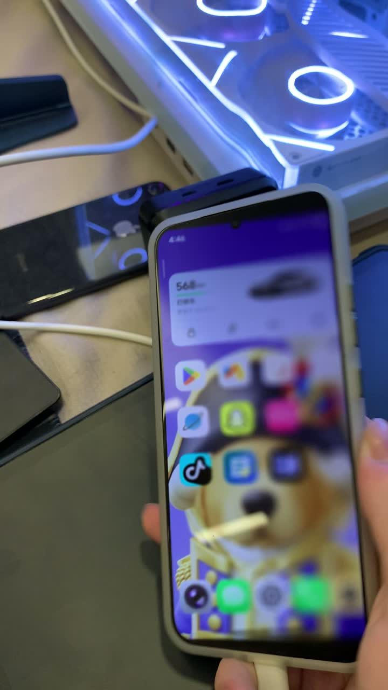
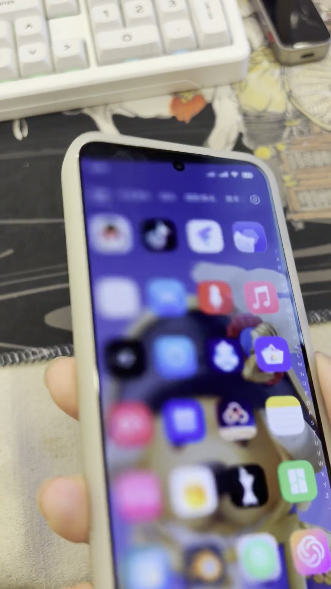
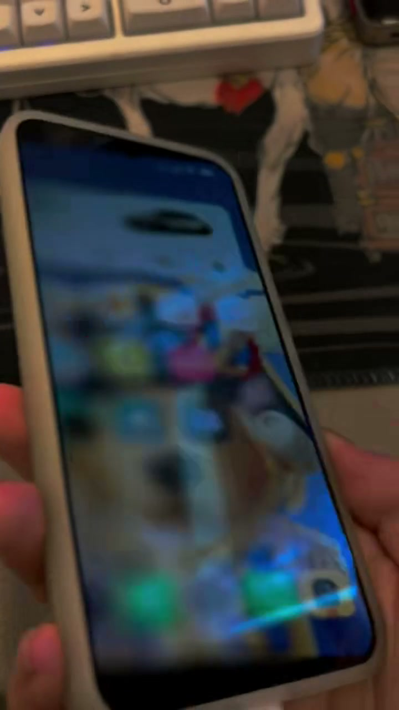
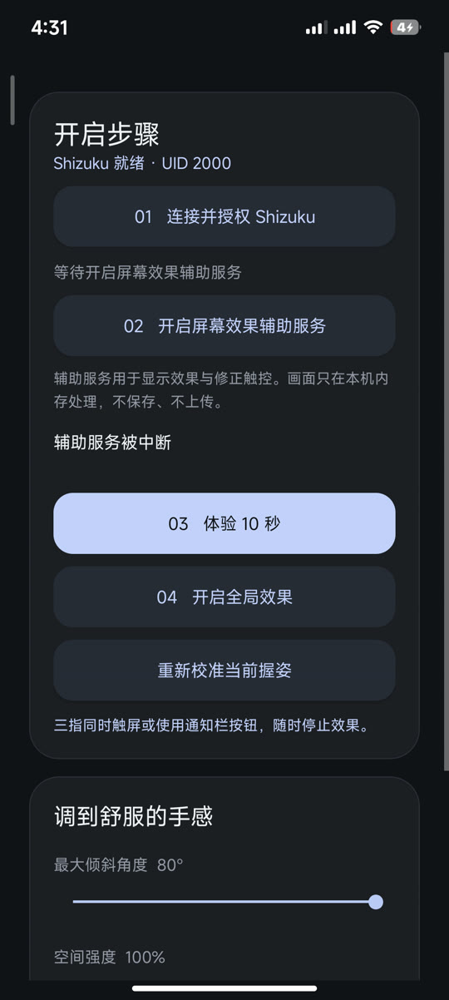
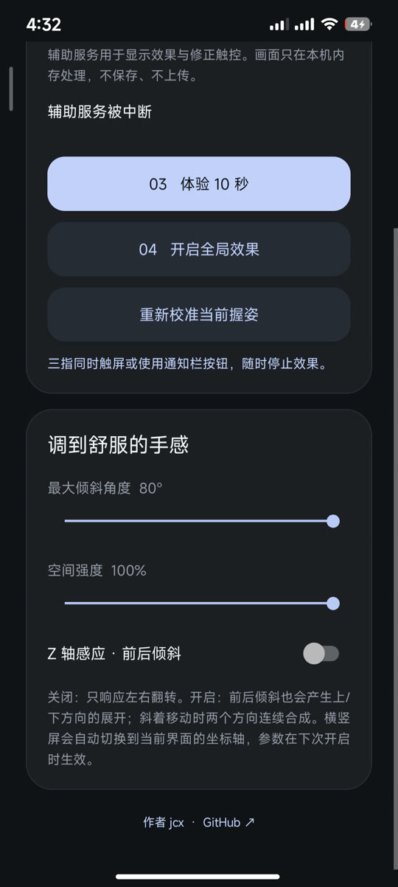

# Duo Fold for Android（简体中文）

[English](README.md) · 简体中文

# 本维护版改动（v0.4.0）

> 本仓库是 [jcx396905-gif/DuoFold](https://github.com/jcx396905-gif/DuoFold) 的**维护分支**（MIT 协议，原作者 Simon / jcx396905-gif），针对最新 Android（Android 14–17）与日常使用体验做了以下增强。

## 1. Android 17 兼容适配 🛠️

原版在最新 Android（Android 17 / API 37）上**无法使用 Shizuku 授权**，申请权限时直接崩溃：

```
NoSuchMethodException: android.view.SurfaceControl.getInternalDisplayToken
```

- **原因**：Android 17 重构了 `SurfaceControl` 的部分 API，删除了旧版 `getInternalDisplayToken()` 等内部入口，原版二进制直接调用已不存在的符号，导致反射/直接调用抛 `NoSuchMethodException`，授权流程中断。
- **修复**：适配新版 `SurfaceControl` 的 API 形态，改用 Android 17 仍支持的调用路径获取显示源，授权与采集链路在 Android 14–17 全系可用。
- 同时修复了开启效果后**画面上下颠倒**、**截取画面内容被裁切（右侧/上下看不到）**、**状态栏与 Dock 缺失**等问题，采集内容按整屏对齐，沉浸显示正常。

## 2. 更多可调功能 🎚️

"调到舒服的手感"面板（原版仅 3 个参数）扩展为 **6 项实时可调**：

| 参数 | 范围 | 说明 |
|---|---|---|
| 最大倾斜角度 | 15°–80° | 控制触发效果的最大倾斜幅度 |
| 空间强度 | 20%–100% | 透视与景深的整体强度 |
| 模糊强度 | 0%–200% | 倾斜时屏幕外围的模糊程度 |
| 拉扯幅度 | 0%–150% | 倾斜时两侧画面的拉伸幅度（原版拉扯感过强，现可细致调整） |
| 帧数上限 | 30–180 Hz | **自定义帧率上限**，高刷屏（如 120Hz）不再被锁死在 ~30FPS |
| Z 轴感应 | 开/关 | 前后倾斜响应（上下方向展开），可与左右翻转连续合成 |

所有滑条均带 **拖动防抖提交**（松手 260ms 后才落盘），拖动过程中值实时刷新；开关与滑条在拖动时会**锁定页面滚动**，不会把整页带走误触。

## 3. 更美的界面观感 🎨

界面在原有 iOS 风格基础上对齐 KernelSU / BG Next 的顶级质感：

- **可折叠大标题 + 常驻毛玻璃**：大标题随滚动平滑折叠；顶栏整条（含状态栏区域）为真实毛玻璃（textureBlur 25f + 87% surface 混合），滚动时内容直接从玻璃下穿过，永不与标题重叠。
- **全局沉浸式（edge-to-edge）**：状态栏与底部小白条全透明，内容延伸到屏幕边缘，状态栏图标跟随系统深浅色自动适配。
- 顶栏深色切换按钮无涟漪遮罩、随折叠淡出，折叠后隐藏。
- 卡片内元素边距、按钮间距、标题字重等细节统一对齐。

## 4. 性能优化与 Vulkan 渲染 ⚡

- **新增 Vulkan 渲染（直连加速）**：跳过 SurfaceTexture 中间拷贝，采集帧直通 GPU，帧率更高、延迟更低；提供 **Vulkan / OpenGL 切换开关**，兼容优先选 OpenGL，帧率优先选 Vulkan。
- 修复原版**锁帧 30FPS** 的问题，配合帧数上限滑条可在高刷屏上跑满。
- 修复**画面抽搐 / 闪屏**（新旧画面交替）问题，渲染与合成节奏对齐。

## 构建

- Android Studio / Gradle 直接打开本仓库即可构建；`app/` 为主要应用模块，`miuix/`、`backdrop/` 为本地依赖模块。
- Vulkan 路径需要 NDK/CMake 支持（`app/src/main/cpp/`）。

## 许可

MIT License（与上游一致），版权归原作者与后续贡献者。

---

# 项目介绍

在普通 Android 设备上实现 **iPhone Duo 风格的整屏翻折动效**，无需折叠屏硬件，也无需 Root。界面会跟随手机的左右、前后倾斜实时投影，可暂停、反向移动，并支持横竖屏方向映射。

<a href="https://github.com/jcx396905-gif/DuoFold/releases/download/v0.4.0/DuoFold-IMG-0019.mov"></a>

▶ [播放最新实机演示（约 23 秒）](https://github.com/jcx396905-gif/DuoFold/releases/download/v0.4.0/DuoFold-IMG-0019.mov)

## 更多测试视频

<a href="https://github.com/jcx396905-gif/DuoFold/releases/download/v0.4.0/DuoFold-full-test.mp4"></a>

▶ [播放完整测试视频（约 30 秒）](https://github.com/jcx396905-gif/DuoFold/releases/download/v0.4.0/DuoFold-full-test.mp4)

<a href="https://github.com/jcx396905-gif/DuoFold/releases/download/v0.4.0/DuoFold-demo-clip.mp4"></a>

▶ [播放演示切片（约 6 秒）](https://github.com/jcx396905-gif/DuoFold/releases/download/v0.4.0/DuoFold-demo-clip.mp4)

## 界面截图

<p align="center">
  
  
</p>

## 特性

- 将整个 Android 屏幕视为连续空间曲面，应用透视、平移、磨砂模糊与光照效果。
- 使用设备运动传感器实时驱动效果：停手机则停，反方向则自然还原。
- 默认支持左右翻转；可选 **Z 轴感应 · 前后倾斜**，斜向移动时两个方向连续合成。
- 自动适配横竖屏并映射坐标系，切换后自动校准。
- 不改启动器布局、不改第三方 App UI，效果直接渲染在当前界面之上。
- Android 14+ 可通过三指触屏、通知栏操作或返回 DuoFold 停止效果（兼容构建使用通知栏停止）。

## 需求

- 标准构建需要 Android 14 及以上；兼容分支支持 Android 10+。
- 需安装并运行 [Shizuku](https://github.com/RikkaApps/Shizuku)。
- **无需 Root。**

## 使用

1. Android 14+ 下载标准版，Android 10–13 下载兼容分支版本。
2. 打开 Shizuku，通过无线调试或 ADB 启动服务。
3. 打开 DuoFold，点 **01 连接并授权 Shizuku**，在授权弹窗允许。
4. 点 **02 开启屏幕效果辅助服务**，找到 DuoFold 并开启。
5. 正对屏幕自然握持手机，点 **03 体验 10 秒**，左右倾斜查看翻折效果。
6. 按手感调整**最大倾斜角度**与**空间强度**，需要前后倾斜时再开启 **Z 轴感应**（默认关闭），参数在下次开启效果时生效。
7. 点 **04 开启全局效果**；换握姿后可点 **重新校准当前握姿**。
8. Android 14+ 用三指触屏或通知栏停止；Android 10–13 用通知栏停止。

若辅助服务显示已连接但效果未启动，请关闭再重开一次辅助服务。部分小米系统还需在开发者选项中开启 **USB 调试（安全设置）** 以支持触控修正。

## 工作原理

通过 Shizuku 获取当前显示画面，经本地内存传递到渲染器（默认 OpenGL ES，可选 Vulkan 直连路径），利用 游戏旋转矢量 + 陀螺仪 计算设备相对姿态；无对应传感器时兼容构建退化为重力/加速度计。画面按当前显示方向重建，横竖屏切换后自动校准更新。

默认参数：**80° 最大倾斜角度**、**100% 空间强度**、**6–32 模糊采样**、**40ms 陀螺仪预测**。本维护版新增帧数上限（30–180Hz），高刷屏不再被锁 30FPS。

## 隐私与限制

- 应用无网络权限，正常使用中画面既不上传也不保存。
- 效果悬浮层已从系统截图中排除，避免递归采集。
- Android 10/11 缺乏逐层排除 API，兼容构建在启动时采集一帧真实画面后由传感器驱动该帧，重启效果或旋转屏幕可刷新画面。
- Android 10–13 不支持 Android 14 引入的辅助功能触控坐标修正，倾斜时交互困难请先回到校准姿态。
- 受保护/禁止截屏的内容可能显示为黑色。
- 本应用只改变最终显示画面，不改变任何应用内的图标、文字与组件。
- 长时间使用会增加 GPU 负载与耗电。

## 从源码构建

需要 JDK 17 与 Android SDK 36：

```shell
./gradlew :app:assembleStandardDebug :app:assembleCompatDebug :motion:test
```

标准构建产物位于 `app/build/outputs/apk/standard/debug/app-standard-debug.apk`；兼容构建位于 `app/build/outputs/apk/compat/debug/app-compat-debug.apk`。

项目包含两个模块：`app` 负责 Shizuku 集成、辅助服务、画面采集与 OpenGL ES / Vulkan 渲染；`motion` 负责姿态轴映射、滤波与投影数学，可独立运行 JVM 单元测试。

## 作者

[jcx](https://github.com/jcx396905-gif)

## 许可

MIT License。第三方许可声明见 `app/src/main/assets/THIRD_PARTY_NOTICES.txt`。